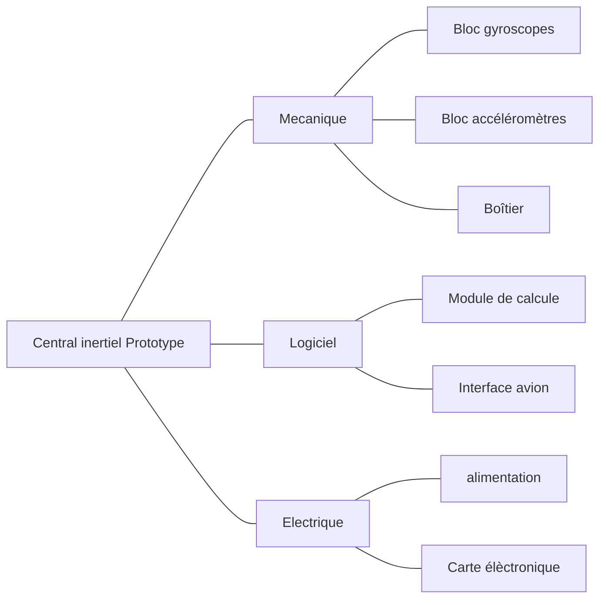
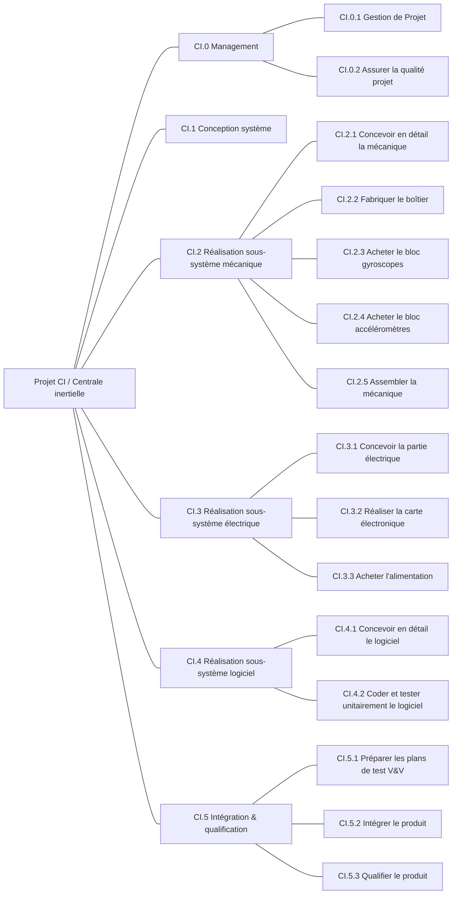
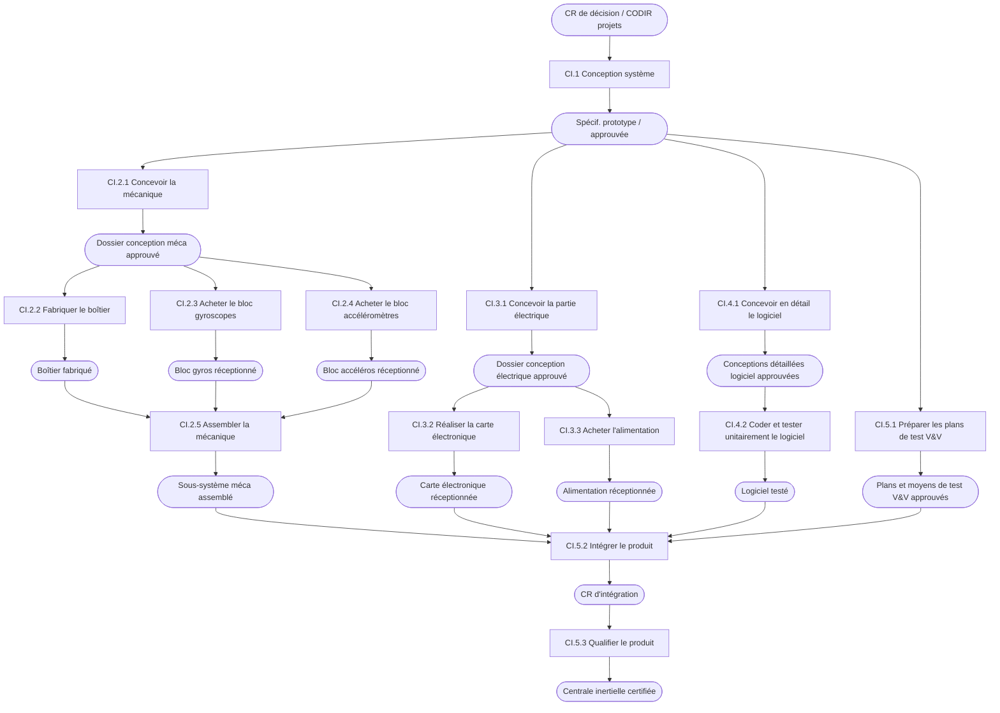

# PBS (Product Breakdown Structure)

# WBS (Work Breakdown Structure)

# Diagramme de flux

# RAM (Responsibility Assignment Matrix)

| Code WBS | Activité                                 | Chef de projet | Ingénieur qualité | Ingénieur dév. | Technicien dév. | Directeur de projet |
| -------- | ---------------------------------------- | :------------: | :---------------: | :------------: | :-------------: | :-----------------: |
| CI.0.1   | Gérer le projet                          |       R        |                   |                |                 |          A          |
| CI.0.2   | Assurer la qualité projet                |                |         R         |                |                 |          A          |
| CI.1     | Conception système                       |                |                   |       R        |                 |          A          |
| CI.2.1   | Concevoir en détail la mécanique         |                |                   |       R        |                 |                     |
| CI.2.2   | Fabriquer le boîtier                     |                |                   |       R        |        P        |                     |
| CI.2.3   | Acheter le bloc gyroscopes               |       R        |                   |       A        |                 |                     |
| CI.2.4   | Acheter le bloc accéléromètres           |       R        |                   |       A        |                 |                     |
| CI.2.5   | Assembler la mécanique                   |                |                   |       R        |        P        |                     |
| CI.3.1   | Concevoir la partie électrique           |                |                   |       R        |        P        |                     |
| CI.3.2   | Réaliser la carte électronique           |       R        |                   |       A        |                 |                     |
| CI.3.3   | Acheter l'alimentation                   |       R        |                   |       A        |                 |                     |
| CI.4.1   | Concevoir en détail le logiciel          |                |                   |       R        |                 |                     |
| CI.4.2   | Coder et tester unitairement le logiciel |                |                   |       R        |        P        |                     |
| CI.5.1   | Préparer les plans de test V&V           |                |                   |       R        |                 |                     |
| CI.5.2   | Intégrer le produit                      |                |                   |       R        |        P        |                     |
| CI.5.3   | Qualifier le produit                     |                |                   |       R        |        P        |          A          |

